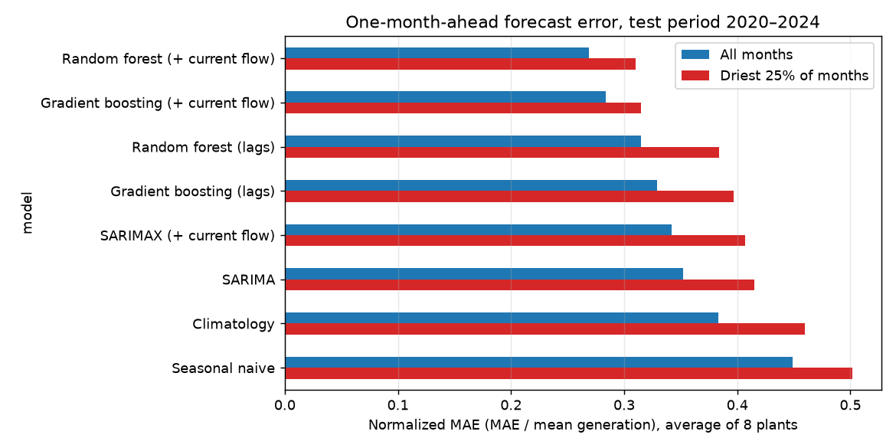
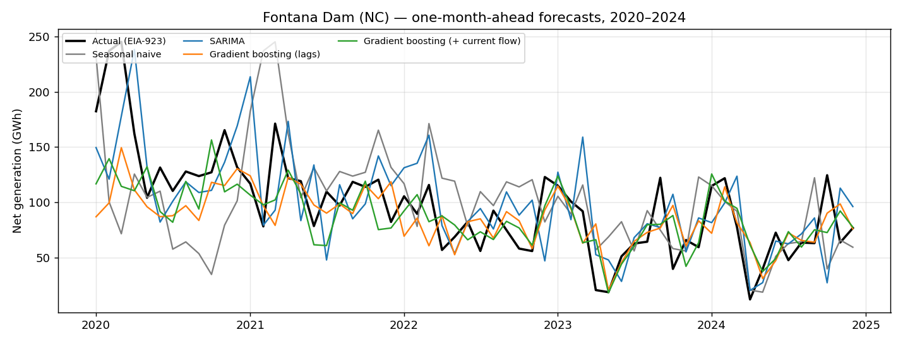

# us-hydro-forecast

Open-source benchmark of statistical and machine-learning models for forecasting
monthly hydropower generation at U.S. plants, using only free public federal data.

**Author:** Akwasi Agyei (M.Stat., North Carolina State University)
**Status:** work in progress — Phase 1 (Southeast U.S. plants)

## Why

Hydropower is the largest source of flexible renewable power on the U.S. grid, and
its output swings with rainfall and drought. Operators, utilities and planners need
reliable forecasts of how much a plant will produce next month and next season.
This project builds a reproducible, public benchmark so that different forecasting
methods can be compared on the same plants, the same years and the same metrics.

It extends my earlier published work on hydropower forecasting in Ghana
([ARIMA, 2022](https://doi.org/10.5539/ijsp.v11n5p30);
[structural VAR, 2022](https://doi.org/10.5539/ijsp.v11n3p22)) to U.S. systems,
with richer data and modern machine-learning methods.

## Data (all free and public)

| Source | What | Link |
|---|---|---|
| U.S. Energy Information Administration, Form EIA-923 | Monthly net generation (MWh) by plant, 2010–2024 | https://www.eia.gov/electricity/data/eia923/ |
| U.S. Geological Survey, NWIS | Daily mean streamflow (cfs) at a gage upstream of each plant | https://waterservices.usgs.gov/ |

Eight plants in North and South Carolina (plus the Savannah and Roanoke basins),
each paired with an upstream USGS gage — see [`src/plants.py`](src/plants.py).

## Models

One-month-ahead forecasts, evaluated with a rolling origin over 2020–2024
(60 test months per plant, trained on 2011–2019):

- **Baselines:** seasonal naive (same month last year), climatology (monthly mean)
- **Classical:** SARIMA(1,0,1)(1,1,0)12; SARIMAX with log streamflow as a regressor
- **Machine learning:** random forest and gradient boosting on lagged generation,
  lagged streamflow, rolling means and calendar terms

Models marked **"+ current flow"** also see the current month's observed streamflow.
They are not a real-time forecast; they show how much a good inflow forecast would help.

## Results so far

Normalized MAE (MAE ÷ mean generation), averaged across the 8 plants, 2020–2024:

| Model | All months | Driest 25% of months |
|---|---|---|
| Random forest (+ current flow) | 0.269 | 0.310 |
| Gradient boosting (+ current flow) | 0.284 | 0.315 |
| Random forest (lags only) | 0.315 | 0.384 |
| Gradient boosting (lags only) | 0.329 | 0.397 |
| SARIMAX (+ current flow) | 0.342 | 0.407 |
| SARIMA | 0.352 | 0.415 |
| Climatology | 0.383 | 0.460 |
| Seasonal naive | 0.449 | 0.502 |



Three early takeaways:

1. Adding **lagged streamflow** to a tree model cuts error by about 10 percent
   relative to SARIMA and 30 percent relative to the seasonal naive forecast.
2. Knowing the **current month's inflow** is worth another 15 percent — which is
   why the next step is to plug in actual streamflow forecasts instead.
3. **Every model is worse in dry months.** That gap is the problem that matters
   most to operators, and it is the focus of the next phase.

Per-plant results: [`outputs/results_by_plant.csv`](outputs/results_by_plant.csv).
Example plant (Fontana Dam, NC):



## Reproduce

```bash
pip install -r requirements.txt
cd src
python download_eia923.py 2010 2024   # ~300 MB of EIA zips, a few minutes
python download_usgs.py               # streamflow for the paired gages
python build_dataset.py
python evaluate.py                    # ~2 minutes; writes outputs/
```

Prefer Jupyter? Open [`notebooks/run_pipeline.ipynb`](notebooks/run_pipeline.ipynb) and run the
cells in order. It imports the same `src/` modules and walks through each step with the
data visible in between.

## Roadmap

- [ ] Add NOAA precipitation and drought index (PDSI / SPI) features
- [ ] Replace "current flow" with actual NOAA/NWS streamflow forecasts
- [ ] Multi-step (1–12 month) forecasts and probabilistic (quantile) outputs
- [ ] Extend to TVA, Army Corps and Bureau of Reclamation fleets
- [ ] Add LSTM / temporal-fusion baselines
- [ ] Write up as a preprint

## License

MIT. Data are U.S. federal public-domain sources; please cite EIA and USGS.
